# Moonlight Duo

Moonlight Duo is an unofficial fork of [Moonlight for iOS](https://github.com/moonlight-stream/moonlight-ios),
the open-source game streaming client for [Sunshine](https://github.com/LizardByte/Sunshine),
[Wolf](https://github.com/games-on-whales/wolf) and NVIDIA GameStream hosts. It adds:

- support for **iPhone Duo**, on both displays and in every pose
- a new **SwiftUI** interface
- the **touch gamepad** from [nxnative](https://github.com/seedds/nxnative)

All of Moonlight's streaming, pairing and input code is kept as it is.

> Moonlight Duo is not affiliated with or endorsed by the Moonlight Game Streaming Project or
> Apple. If you don't need the additions below, use the official
> [Moonlight on the App Store](https://apps.apple.com/app/moonlight-game-streaming/id1000551566).

<p align="center">
  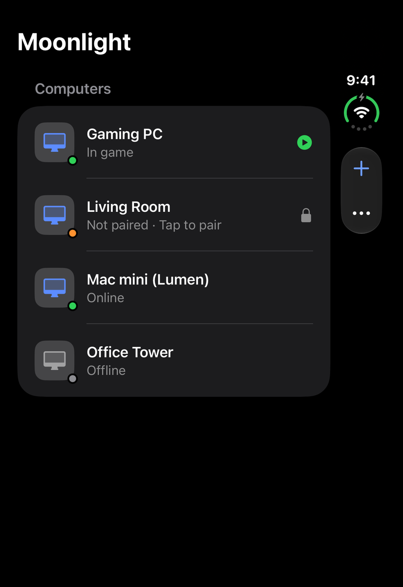
  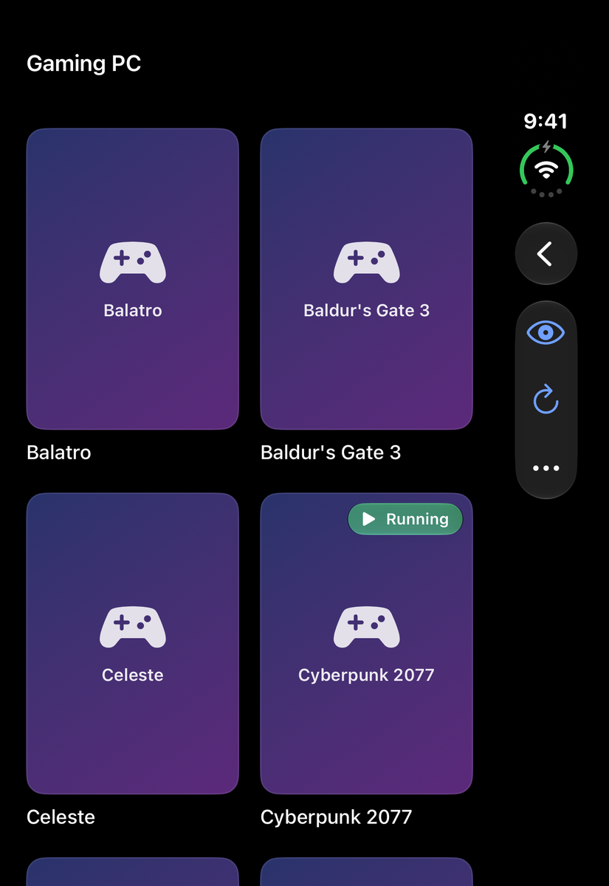
  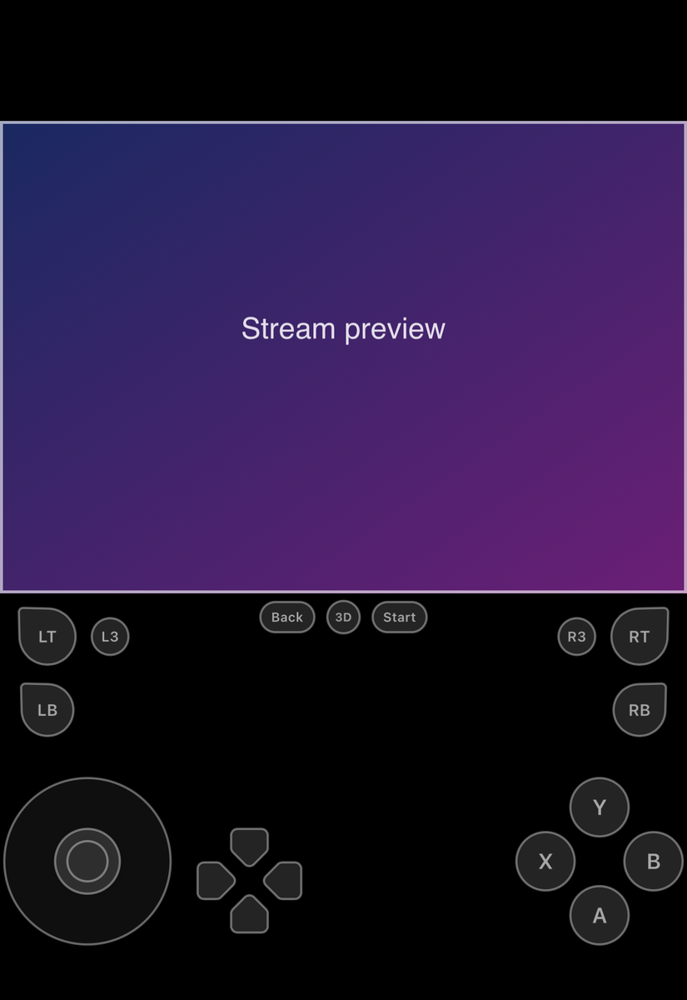
  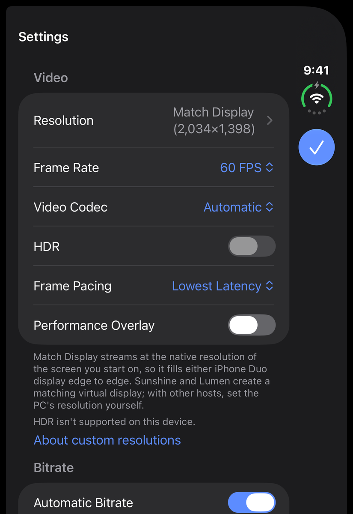
  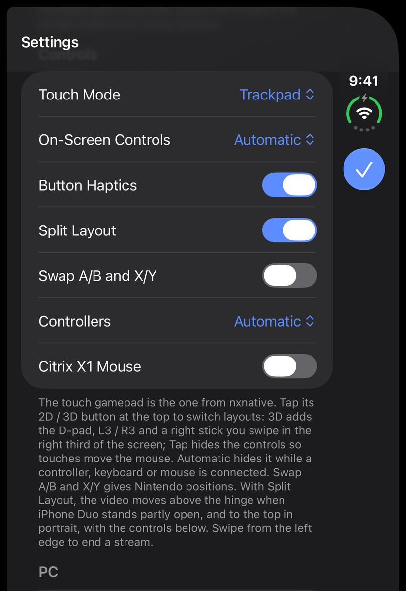
</p>

## Download

Get the latest unsigned `.ipa` from **[Releases](../../releases/latest)**. Next to it are
`SHA256SUMS.txt` and the settings self-test report for that build.

1. **Verify the download.** In the folder that holds both files, run
   `shasum -a 256 -c SHA256SUMS.txt`. It should print `OK`. GitHub also shows each release
   file's SHA-256 digest next to it.
2. **Sideload it.** The `.ipa` is unsigned, so your sideloading tool signs it with your own
   Apple account when it installs: AltStore, SideStore, Sideloadly, Local Sideload, or Xcode
   with `devicectl`. The app's bundle ID is `com.moonlight-duo.Moonlight`, so it installs next
   to the App Store Moonlight.
3. **Pair it.** Open the app, pick your PC and enter the PIN it shows on the host.

It needs iOS 26 or later. It's built for iPhone Duo and works on other iPhones too, where the
Duo features simply stay off. iPad hasn't been tested.

## What's new

### iPhone Duo

| Outer display, landscape | Inner display | Book pose (fold down the middle) |
| :---: | :---: | :---: |
| 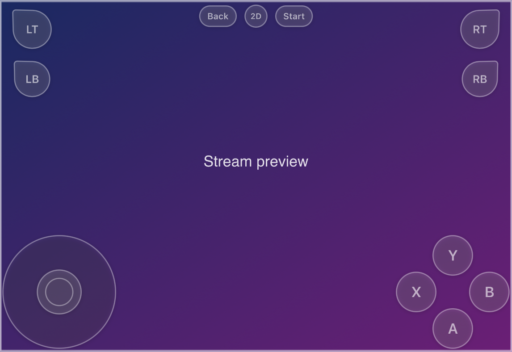 | 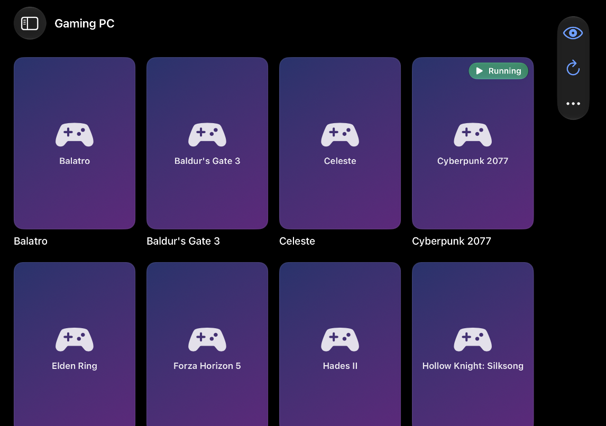 | 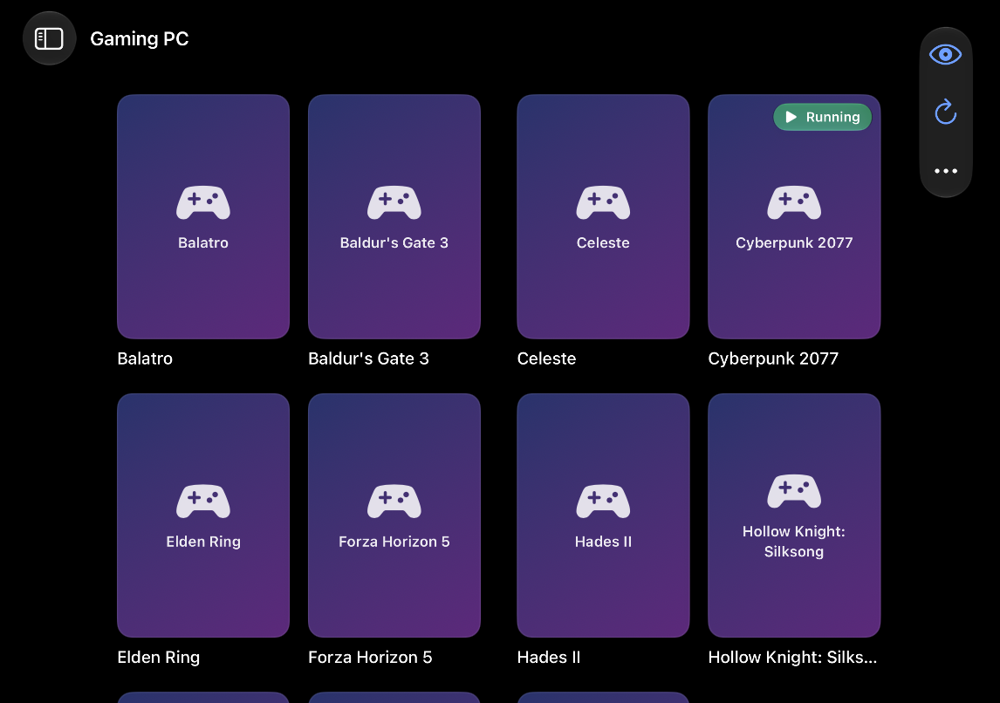 |
| 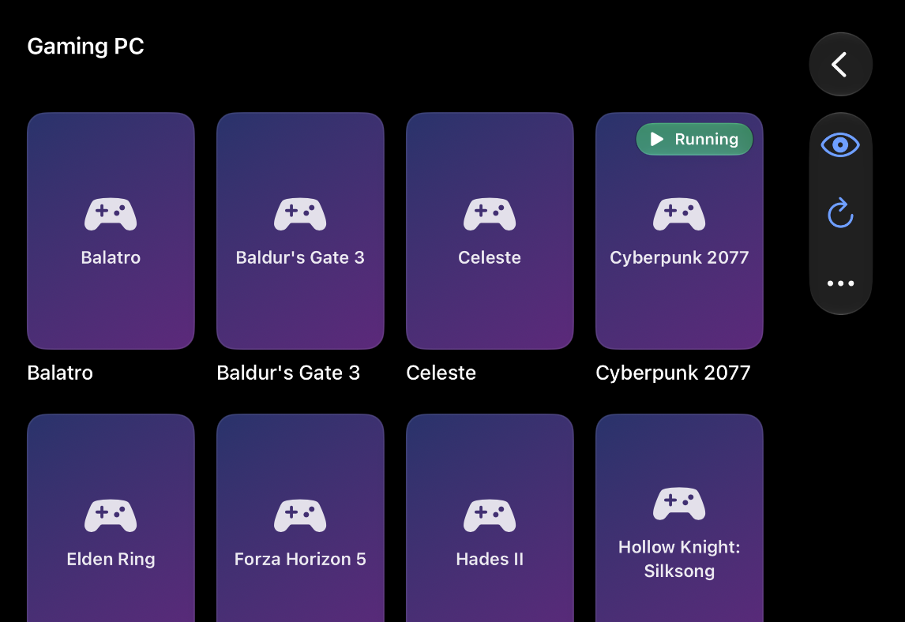 | 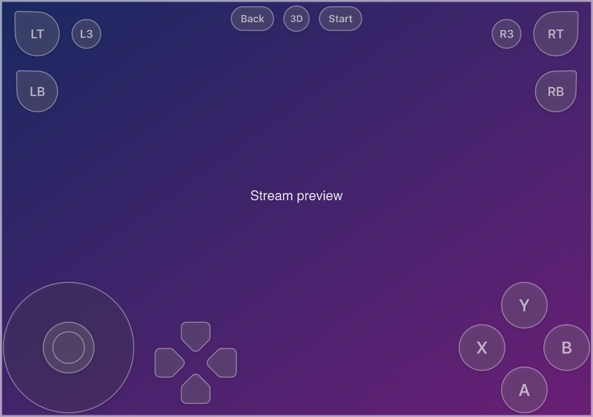 | 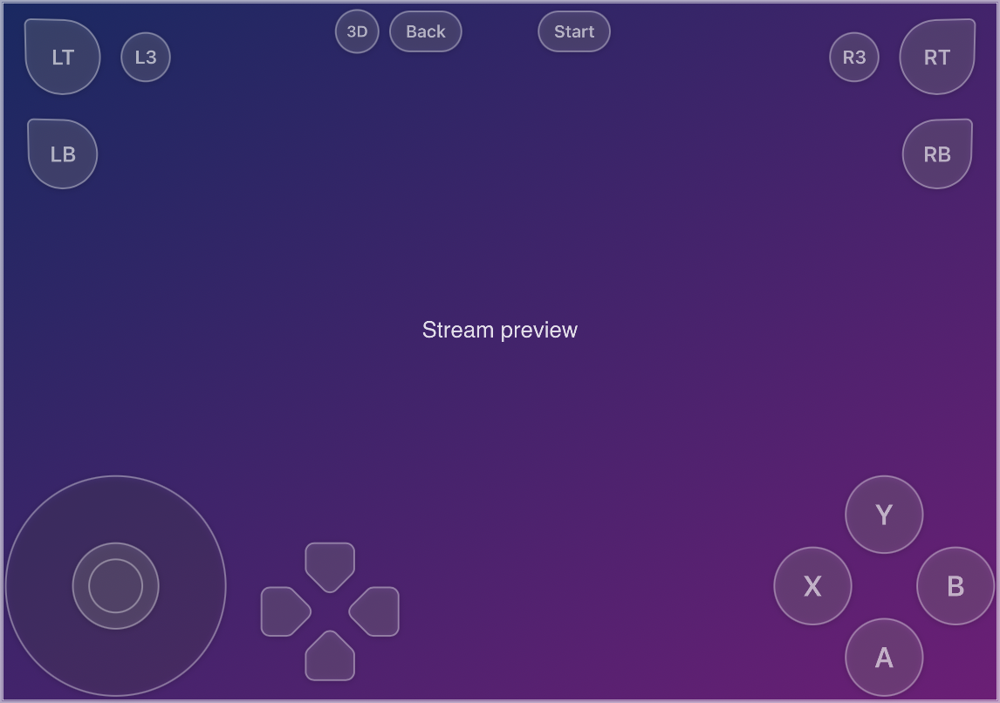 |

| Inner display, portrait | Tabletop pose (fold across) |
| :---: | :---: |
| 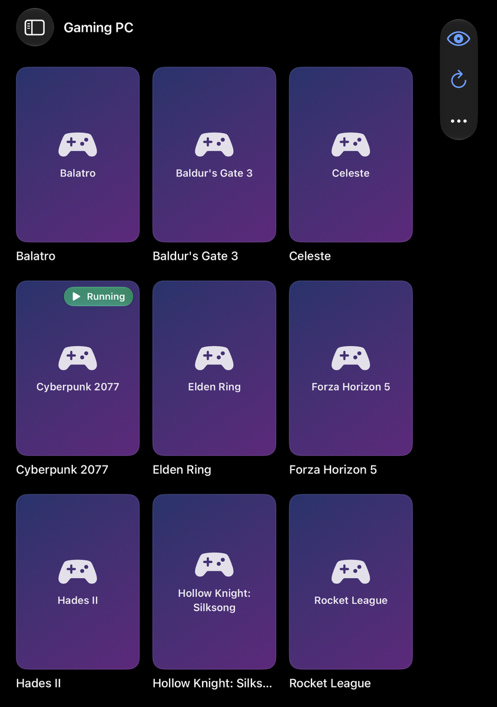 | 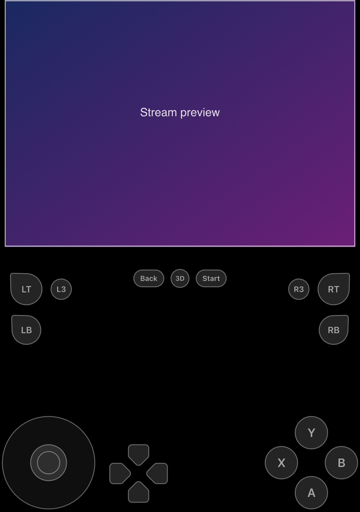 |

- **Every display and orientation.** Works on the outer and inner displays in portrait and
  landscape. Layouts follow size classes rather than the device model, so the inner display
  gets the full two-column layout.
- **Fold-aware layout.** It reads the hinge position from the iOS 27 reserved-region API
  (`.division`):
  - The game grid splits evenly around the fold, so no tile sits on the hinge.
  - The gamepad's top buttons move off the fold.
- **Split Layout.** When the phone stands half-open (tabletop) or is held in portrait, the
  video sits above the hinge or at the top, and the gamepad gets the area below. In landscape
  the gamepad sits over the full-screen video, as it always has.
- **Match Display.** Streams at the exact pixel size of the display you start on, so either
  display is filled edge to edge. Sunshine and similar hosts can create a virtual display at
  that size.
- Adopts the UIScene life cycle. Stock Moonlight does not launch when built with the iOS 27
  SDK.

### Touch gamepad

A port of the virtual gamepad from [nxnative](https://github.com/seedds/nxnative). The button
at the top cycles through three layouts:

- **2D:** triggers and bumpers in the top corners, Back and Start at the top centre, the left
  stick bottom-left and the face buttons bottom-right. You can slide a finger between face
  buttons.
- **3D:** adds an 8-way D-pad, L3 and R3, and a right stick. Touch anywhere in the right
  third of the screen to use the right stick.
- **Tap:** hides the controls so touches go to the stream as mouse or touch input.

The gamepad reaches the host as a standard Xbox-style controller, through Moonlight's
on-screen controller slot. When a physical controller connects, it joins that same player-1
slot.

With On-Screen Controls set to **Automatic** (the default), the gamepad hides while a
controller, keyboard or mouse is connected. **Swap A/B and X/Y** gives Nintendo positions.
**Button Haptics** can be turned off.

### Settings

Every setting from Moonlight's original settings screen is kept:

- resolution, frame rate, bitrate, video codec, HDR, frame pacing and the performance overlay
- touch mode, on-screen controls, Swap A/B and X/Y, multiple controllers and Citrix X1 mouse
- Optimize Game Settings and Play Audio on PC

Settings are stored in the same place as before. New options: **Match Display**, **Safe Area**
(the original "safe area" choice), **Automatic Bitrate**, **Split Layout** and
**Button Haptics**.

## Verification

Debug builds include a self-test, run with the launch argument `-MLSettingsSelfTest YES`. It
writes `Documents/settings-selftest.txt`. The report for each release is attached to that
release, and the current one is in
[docs/verification/settings-selftest.txt](docs/verification/settings-selftest.txt).

It checks, 124 checks in all:

- every setting round-trips through the new Settings screen into Moonlight's original Core
  Data record and back
- for five setting combinations, the new code builds a stream configuration identical to the
  original `MainFrameViewController`'s
- Match Display, Safe Area and Automatic Bitrate behave as described
- the touch gamepad: each button, trigger, D-pad direction and stick is pressed with synthetic
  touches through its real touch handlers, then checked against the controller state that is
  sent to the host
- no two gamepad controls overlap at seven iPhone and iPhone Duo sizes

## Building

Requires Xcode 27.1 or later and the iOS 27 SDK.

```sh
git clone --recursive <this repository's URL>
cd moonlight-duo
xcodebuild -project Moonlight.xcodeproj -scheme Moonlight -configuration Release \
  -destination 'generic/platform=iOS' -derivedDataPath build/DerivedData \
  CODE_SIGNING_ALLOWED=NO DEPLOYMENT_POSTPROCESSING=YES build
mkdir -p build/ipa/Payload
cp -R build/DerivedData/Build/Products/Release-iphoneos/Moonlight.app build/ipa/Payload/
(cd build/ipa && zip -qry "Moonlight Duo.ipa" Payload)
```

To run from Xcode on a device, set your own team and bundle ID under Signing & Capabilities.
New sources go in `Limelight/Modern/`. `BuildScripts/duo_add_files.py` adds them to the
Xcode project and applies the build settings (bundle ID, iOS 26 deployment target, Swift
`DEBUG` flag). It is safe to run more than once.

### Debug tools

Debug builds accept these launch arguments, so you can test layouts and settings without a
host:

| Argument | Effect |
| --- | --- |
| `-MLDemo YES` | Demo PCs and games; streams show a test pattern |
| `-MLHarness 890x626` | Lays the app out at another display size (for example the inner display) and scales it into the window |
| `-MLSimulateFold vertical` / `horizontal` | Simulates a hinge for the fold-aware layouts |
| `-MLSettingsSelfTest YES` | Runs the self-test described above |
| `-MLPairHost <name or IP> -MLPairPIN 1234` | Pairs without the UI, using a fixed PIN |
| `-MLStartStream "<app>" -MLStreamProbe YES` | Starts a stream, presses gamepad buttons, logs stream stats, then ends the stream |

`BuildScripts/duo_shots.sh` runs the self-test and takes the screenshots above on a booted
iPhone Duo simulator.

The simulator does not open the inner display or change pose from the command line. So the
outer-display screenshots are real simulator captures, while the inner-display and fold
screenshots are layout renders made with `-MLHarness` and `-MLSimulateFold`.

## Known limitations

- The inner display, fold poses and the touch gamepad are tested in the simulator and with
  layout renders. Live testing on iPhone Duo hardware is ongoing.
- On hosts running [Wolf](https://github.com/games-on-whales/wolf), controller, mouse and
  keyboard input needs `/dev/uinput` on the host. Without it, video streams but input is
  dropped.
- The tvOS target (`Moonlight TV`) is unchanged from upstream and is not built or tested here.

## Credits

- **[Moonlight for iOS](https://github.com/moonlight-stream/moonlight-ios)** and
  **[moonlight-common-c](https://github.com/moonlight-stream/moonlight-common-c)** by the
  Moonlight Game Streaming Project: the streaming client this fork is built on (GPL-3.0).
- **[nxnative](https://github.com/seedds/nxnative)** by seedds: the touch gamepad design and
  code (MIT).
- **[X1Kit](https://github.com/cgutman/X1Kit)**, ENet, nanors, FFmpeg, SDL2, Opus and
  OpenSSL, bundled by Moonlight.
- **[Sunshine](https://github.com/LizardByte/Sunshine)** and
  **[Wolf](https://github.com/games-on-whales/wolf)**, the hosts this app streams from.

The full license texts are in [THIRD_PARTY_NOTICES.md](THIRD_PARTY_NOTICES.md).

## License

GPL-3.0, the same as Moonlight; see [LICENSE.txt](LICENSE.txt). This is a modified version of
Moonlight for iOS. The changes are listed above, and every file that was changed or added is
in this repository's history.
